# Traffic Sign Recognition with a Spatial Transformer ResNet

A convolutional neural network for the **German Traffic Sign Recognition Benchmark (GTSRB)**, designed and implemented from scratch in PyTorch. No pretrained weights and no model-zoo architectures are used. The spatial transformer, the residual blocks, the GPU augmentation pipeline, the training loop and Grad-CAM are all written in one notebook.

<p align="center">
  <b>99.33% accuracy on the official GTSRB test set (12,630 images)</b><br>
  single model · 3.32M parameters · trained in 8 minutes on a laptop RTX 3050 (6 GB)<br>
  human performance on the same test set: 98.84% on average, 99.22% for the best individual
</p>

<p align="center">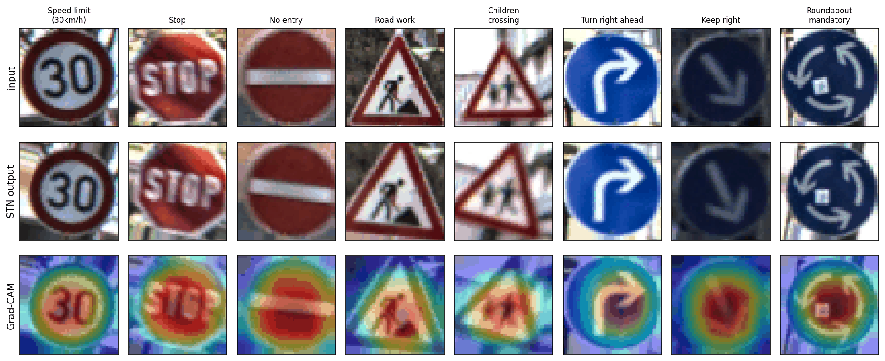</p>
<p align="center"><sub>Test images (top), the output of the learned spatial transformer (middle) and Grad-CAM of the predicted class (bottom). The network attends to the pictogram: the digits, the letters of STOP, the arrows and the figures inside the triangles.</sub></p>

**Notebook:** [`traffic_sign_recognition.ipynb`](traffic_sign_recognition.ipynb) runs top to bottom, and all outputs are included.

## Highlights

- **Architecture written from scratch.** A spatial transformer network (STN) predicts a bounded similarity transform that re-aligns every input before classification, followed by a residual CNN. Squeeze-and-excitation attention was implemented too, but the ablation showed it did not help, so the final model does not use it.
- **Leakage-free validation.** GTSRB training images come in *tracks* of 30 frames of the same physical sign. The validation set is split by track, not by image. Frames from tracks seen in training are classified with 100.00% accuracy, unseen tracks with 99.12%. An image-level split would hide this gap.
- **Data pipeline on the GPU.** The preprocessed dataset (360 MB) lives in GPU memory, and each batch is augmented on the GPU with one `affine_grid` / `grid_sample` call. There is no CPU data loader, and an epoch takes 16 seconds.
- **Label-aware flipping.** Symmetric signs are flipped and keep their label. Mirrored pairs (*keep left / keep right*, *turn left / turn right ahead*, ...) are flipped and swap their label. All other signs are never flipped.
- **Analysis beyond accuracy.** Error analysis, Grad-CAM, a quantitative test of what the STN learned, t-SNE of the features, an ablation study and robustness to corruptions.

## Results

| Metric | Value |
|---|---|
| Test accuracy (official test set) | **99.33%** (85 errors / 12,630) |
| Macro F1 | 0.9932 |
| Validation accuracy (unseen tracks) | 99.12% |
| Test accuracy with 5-view TTA | 99.28% (no gain) |
| Parameters | 3.32M |
| Training time | 8.2 min (30 epochs, RTX 3050 6GB Laptop GPU) |
| Inference | 10,200 images/s (batch 1024), 2.0 ms latency (batch 1) |

### Comparison with published results on GTSRB

| Method | Test accuracy |
|---|---|
| CNN with 3 spatial transformers, Arcos-García et al. 2018 | 99.71% |
| Committee of CNNs, IJCNN 2011 winner, Cireşan et al. 2012 | 99.46% |
| **This project, single model** | **99.33%** |
| Human performance, best individual [1] | 99.22% |
| Human performance, average [1] | 98.84% |
| Multi-scale CNN, Sermanet & LeCun 2011 [1] | 98.31% |
| Random forests, Zaklouta et al. 2011 [1] | 96.14% |
| LDA on HOG features [1] | 95.68% |

[1] Competition results as reported by Stallkamp et al., 2012.

## Method

### Data and preprocessing

The dataset is downloaded automatically from the [Kaggle mirror](https://www.kaggle.com/datasets/meowmeowmeowmeowmeow/gtsrb-german-traffic-sign) of the official release: 39,209 training and 12,630 test images in 43 classes. The images are read directly from the zip archive. Each one is cropped to its annotated ROI, resized to 48×48 and equalized with CLAHE on the L channel of Lab. The preprocessed arrays are cached (20 s on the first run).

<p align="center">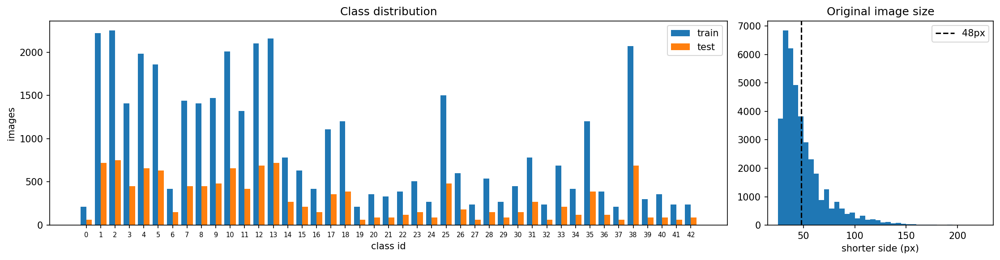</p>

The classes are imbalanced (210 to 2,250 images), and 62% of the images are smaller than 48 px on their short side. Many images are very dark. CLAHE alone does not fix the darkest ones, so every image is also **standardized with its own mean and standard deviation** before it enters the network. This one change halved the number of test errors (265 → 134 in 15-epoch runs).

### Track-based split

10% of the tracks of every class are held out for validation (35,219 train / 3,990 validation images from 1,307 tracks). The best checkpoint is selected on this split.

### Augmentation

All augmentations run on the GPU on whole batches: rotation ±15°, scale 0.85 to 1.15, shear and translation, brightness / contrast / saturation jitter, blur, sensor noise and random occluders, plus the label-aware flip. In the figure below, `33 → 34` and `38 → 39` are flips that changed the label.

<p align="center">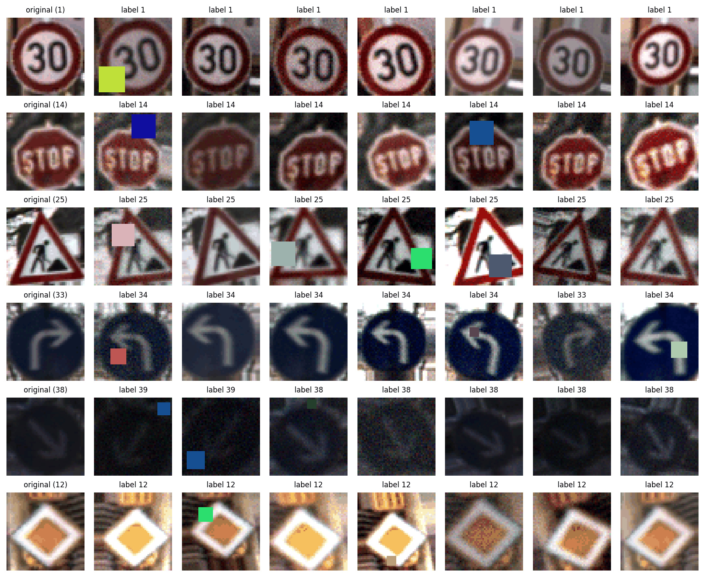</p>

### Architecture

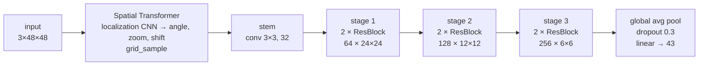

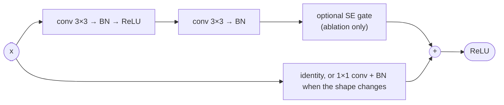

| Part | Output | Parameters |
|---|---|---|
| Spatial transformer (localization CNN + regressor) | 3×48×48 | 552K |
| Stem: conv 3×3 + BN + ReLU | 32×48×48 | 1K |
| Stage 1: 2 residual blocks | 64×24×24 | 132K |
| Stage 2: 2 residual blocks | 128×12×12 | 526K |
| Stage 3: 2 residual blocks | 256×6×6 | 2.10M |
| Global average pooling, dropout, linear | 43 | 11K |
| **Total** | | **3.32M** |

**Spatial transformer.** A small CNN (three conv-BN-ReLU-maxpool layers and two linear layers) predicts a rotation (±30°), a zoom (0.8 to 1.2) and a shift (±10%). The values are bounded with `tanh`, and the last layer is zero-initialized so training starts from the identity transform. The input is resampled with the transform and passed to the backbone. The STN is trained end-to-end through the classification loss only.

### Training

| Setting | Value |
|---|---|
| Optimizer | SGD, Nesterov momentum 0.9, weight decay 5e-4 |
| Learning rate | one-cycle, peak 0.1 (STN: 0.01), 20% warm-up |
| Loss | cross-entropy with label smoothing 0.1 |
| Batch size / epochs | 256 / 30 |
| Precision | mixed precision (fp16 autocast + gradient scaling) |
| Checkpoint | best validation accuracy (track-based split) |

<p align="center">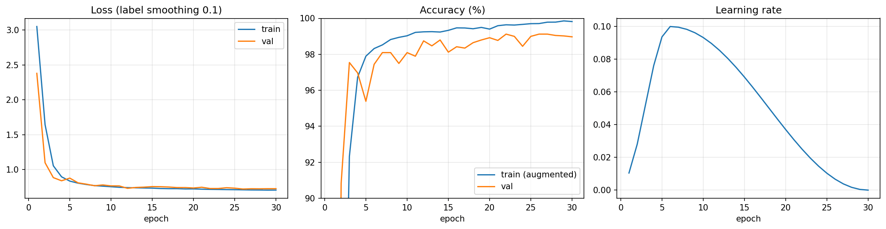</p>

## Analysis

### Errors

<p align="center">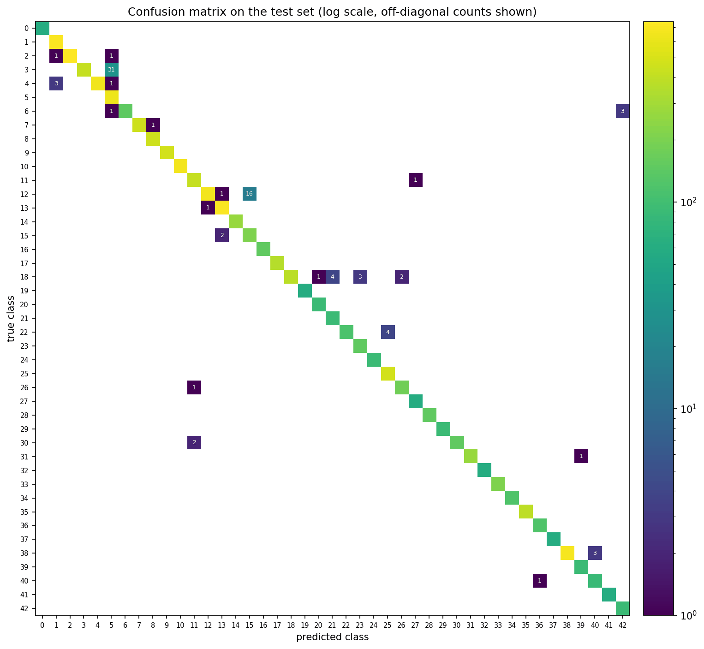</p>

- 76% of the errors are confusions inside the same sign category, mostly between speed limits and between triangular danger signs.
- The errors are concentrated. Like the training set, the test set contains 30 frames of every physical sign, so one difficult sign can cost up to 30 errors. Two confusions account for 55% of all errors (47 / 85):
  - **60 → 80 km/h (31 errors).** The misclassified frames look like the same physical sign, and it is read as 80 with a confidence of 0.8 to 0.9.
  - **Priority road → no vehicles (16 errors).** A priority-road sign so overexposed that its yellow center turns white, which leaves a white shape with a light border.

<p align="center">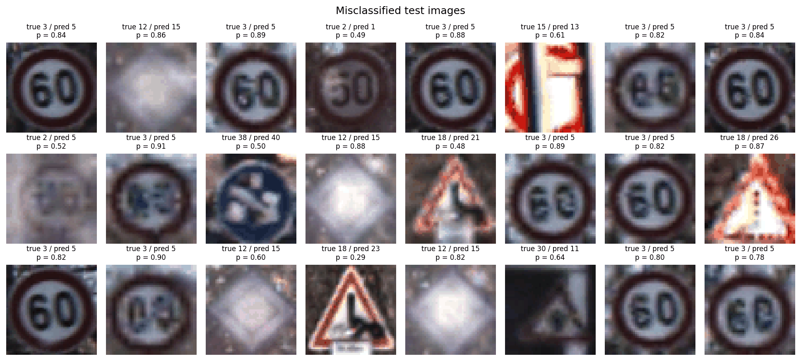</p>

### What the spatial transformer learned

<p align="center">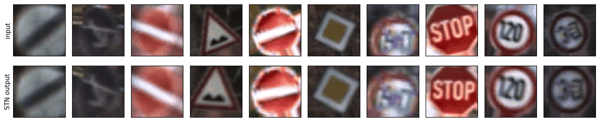</p>

To measure the re-alignment, test images are rotated by a known angle and the rotation predicted by the STN is recorded. Around 0° the STN counter-rotates roughly half of the applied rotation (slope -0.30 over the full ±30° range). It saturates beyond ±15°, the range it saw during training, and adds a constant offset of about -10°, which does not matter because the backbone is trained on the STN output. It also zooms in by 7% on average.

<p align="center">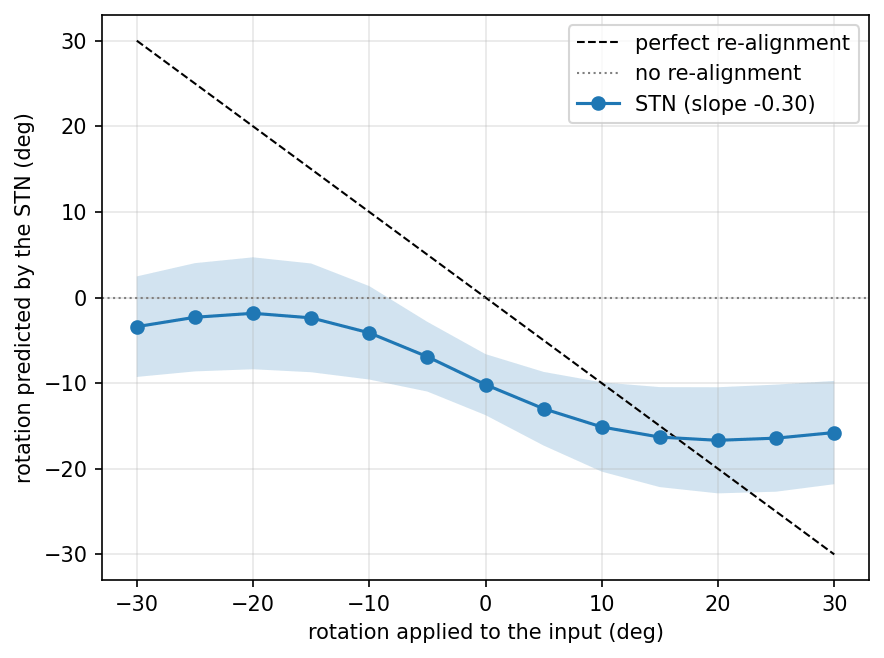</p>

### Learned feature space

<p align="center">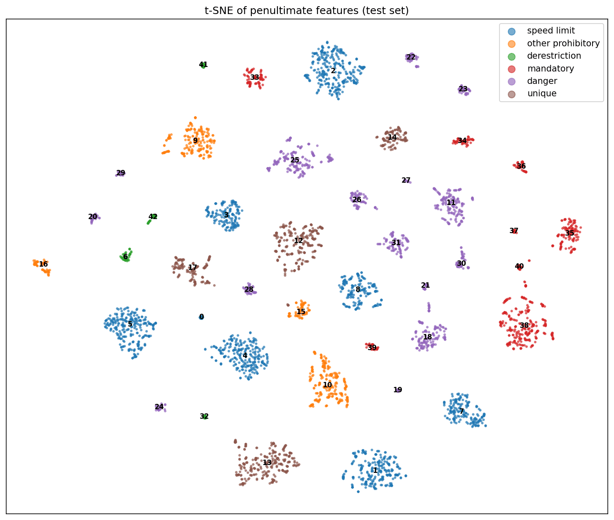</p>

The 256-dimensional features of the test set form one cluster per class, and clusters of the same category lie close to each other.

### Ablation study

Each variant changes one component of the final model and is trained with the same data, schedule, number of epochs and seed.

| Variant | Parameters | Val acc | Test acc | Test errors | Change |
|---|---|---|---|---|---|
| **Final model** (STN + ResNet) | 3.32M | 99.12% | **99.33%** | 85 | |
| + SE attention | 3.37M | 99.07% | 99.22% | 99 | -0.11 |
| without STN | 2.77M | 98.92% | 99.14% | 109 | -0.19 |
| without augmentation | 3.32M | 98.95% | 97.40% | 329 | -1.93 |

- **Augmentation is the most important component.** Without it the model makes 3.9x more test errors. Its validation accuracy (98.95%) hides most of this drop: the validation split contains about 130 physical signs, the test set about 420.
- **The STN gives a small gain on clean images** (24 fewer errors) and a much larger one under distribution shift (next section).
- **SE attention did not help on this dataset.** The same configuration with SE, trained twice, gave 98.92% and 99.22%, so differences of this size are within run-to-run noise.

### Robustness to corruptions

Test accuracy under corruptions that are much stronger than anything seen during training. The augmentation only contains noise up to std 0.05, blur with sigma 1, occluders up to 16 px and rotations up to ±15°.

<p align="center">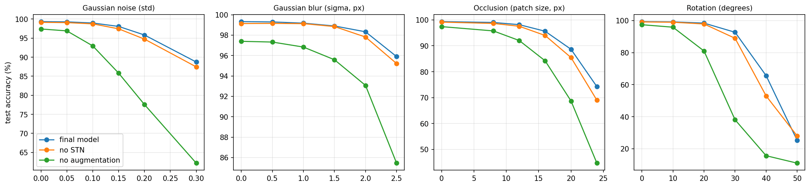</p>

| Corruption | Final model | Without STN | Without augmentation |
|---|---|---|---|
| Gaussian noise, std 0.2 | **95.8%** | 94.7% | 77.6% |
| Gaussian blur, sigma 2.5 px | **95.9%** | 95.2% | 85.5% |
| Occluding patch, 24×24 px (half the image side) | **74.2%** | 69.0% | 44.7% |
| Rotation 30° | **92.7%** | 88.9% | 38.1% |
| Rotation 40° | **65.6%** | 53.0% | 15.7% |

Augmentation accounts for most of the robustness. The STN adds a margin at almost every level of every corruption, and the margin is largest for rotations beyond the training range: +3.8 points at 30° and +12.7 points at 40°. At 50° both models fail. This is where the spatial transformer pays off, more than on the clean test set.

## Development notes

The final design came out of a few iterations. The test numbers are listed here for transparency. The checkpoint itself is always selected on the validation split.

| Version | Change | Val acc | Test acc |
|---|---|---|---|
| v1 | unconstrained 6-parameter affine STN, zero-init residual branches, dataset mean/std normalization (30 epochs) | 98.32% | 97.83% |
| v2 | bounded similarity STN, standard initialization (15 epochs) | 98.60% | 98.24% |
| v3 | + blur, noise and occluder augmentation (15 epochs) | 98.75% | 97.90% |
| v4 | + per-image standardization (15 epochs) | 98.72% | 98.94% |
| v5 | v4 trained for 30 epochs | 98.95% | 98.92% |
| **final** | **v5 without the SE blocks** (selected by validation accuracy in the ablation) | **99.12%** | **99.33%** |

- **The unconstrained STN collapsed.** In v1 the localization network learned extreme zooms: 5% of the test images were zoomed in about 10x, and the backbone learned to classify these crops. Bypassing the STN dropped the accuracy to 59%. Bounding the transform made training stable and much faster to converge.
- **Illumination was the main source of error.** Dataset-level normalization leaves dark images with almost no contrast. Per-image standardization fixed most of these cases.
- **The validation split is small.** It contains about 130 physical signs, so one difficult sign moves the validation accuracy by up to 0.75 points. Differences of a few tenths of a percent between runs are within this noise.

## Limitations and next steps

- The model classifies cropped signs: the ROI is given by the dataset. A complete system needs a detector in front of it, for example trained on GTSDB.
- The remaining errors come from a few physical signs with severe glare or overexposure. Photometric augmentations that simulate specular highlights, or an ensemble, would be the next things to try.
- All numbers come from a single seed. GPU training is also not bit-exact here (cuDNN autotuning, atomic adds in the `grid_sample` backward pass): two runs of the final configuration gave 99.39% and 99.33% test accuracy. A proper comparison of the ablation variants would need several seeds per variant.
- The model was trained on German signs only.

## Reproduce

```bash
# 1. PyTorch with CUDA first (pick the build that matches your driver, see pytorch.org)
pip install torch --index-url https://download.pytorch.org/whl/cu128
# 2. the remaining dependencies
pip install -r requirements.txt
jupyter notebook traffic_sign_recognition.ipynb
```

Running all cells downloads the dataset (640 MB) into `data/`, preprocesses it, trains the main model and the ablation variants, and regenerates every figure in `figures/` and every file in `results/`. The whole notebook takes about 30 minutes on an RTX 3050 laptop GPU: 8 minutes for the main model and the rest for the ablation variants.

The trained weights are in `checkpoints/traffic_sign_net.pt`:

```python
ckpt = torch.load("checkpoints/traffic_sign_net.pt")
model = TrafficSignNet()                 # class defined in the notebook
model.load_state_dict(ckpt["state_dict"])
```

## Repository structure

```
├── traffic_sign_recognition.ipynb   full pipeline: data, model, training, evaluation, analysis
├── checkpoints/
│   └── traffic_sign_net.pt          trained weights
├── figures/                         all figures used in this README
├── results/
│   ├── metrics.json                 test metrics of the final model
│   ├── ablation.csv
│   └── robustness.csv
├── requirements.txt
└── README.md
```

## References

1. J. Stallkamp, M. Schlipsing, J. Salmen, C. Igel. *Man vs. computer: Benchmarking machine learning algorithms for traffic sign recognition.* Neural Networks, 2012.
2. M. Jaderberg, K. Simonyan, A. Zisserman, K. Kavukcuoglu. *Spatial Transformer Networks.* NeurIPS 2015.
3. J. Hu, L. Shen, G. Sun. *Squeeze-and-Excitation Networks.* CVPR 2018.
4. K. He, X. Zhang, S. Ren, J. Sun. *Deep Residual Learning for Image Recognition.* CVPR 2016.
5. R. R. Selvaraju, M. Cogswell, A. Das, R. Vedantam, D. Parikh, D. Batra. *Grad-CAM: Visual Explanations from Deep Networks via Gradient-based Localization.* ICCV 2017.
6. L. N. Smith, N. Topin. *Super-Convergence: Very Fast Training of Neural Networks Using Large Learning Rates.* arXiv:1708.07120, 2017.
7. D. Cireşan, U. Meier, J. Masci, J. Schmidhuber. *Multi-column deep neural network for traffic sign classification.* Neural Networks, 2012.
8. Á. Arcos-García, J. A. Álvarez-García, L. M. Soria-Morillo. *Deep neural network for traffic sign recognition systems: An analysis of spatial transformers and stochastic optimisation methods.* Neural Networks, 2018.
9. P. Sermanet, Y. LeCun. *Traffic sign recognition with multi-scale convolutional networks.* IJCNN 2011.
10. K. Zuiderveld. *Contrast limited adaptive histogram equalization.* Graphics Gems IV, 1994.
